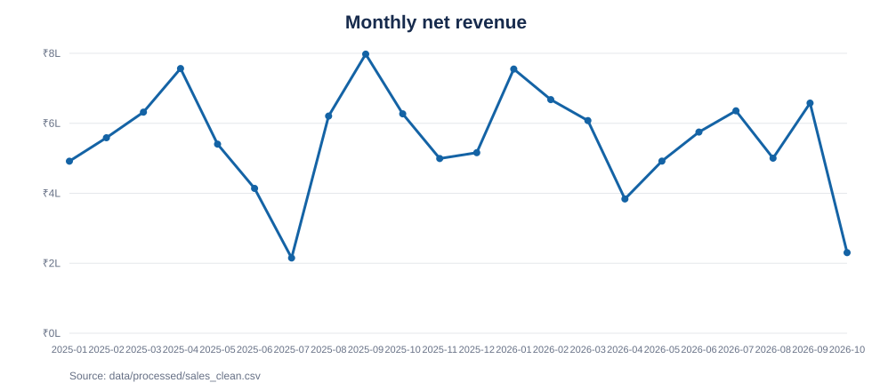
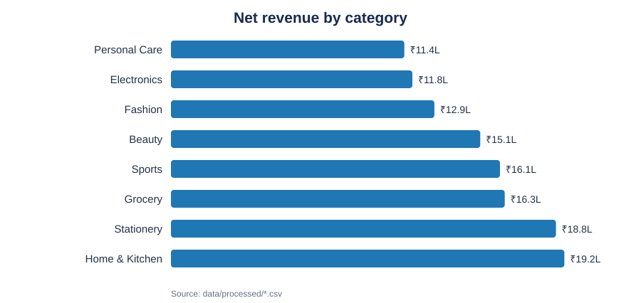
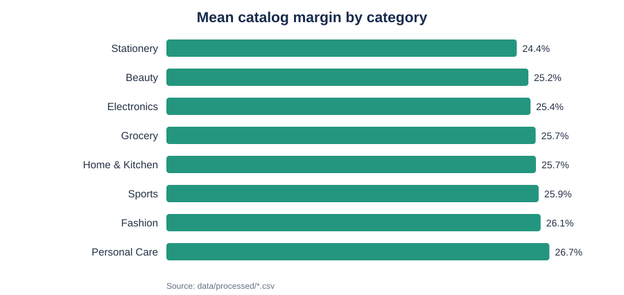
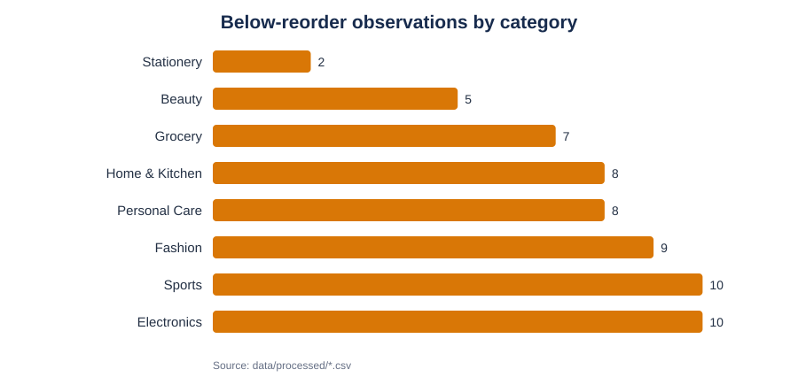

# Day 3 — Exploratory Data Analysis and Business Insights

## Scope and data

This report was calculated from the repository's four Day 2 outputs in `data/processed/`. The raw directory was not used or changed.

- Sales: **500** rows; net recorded revenue **₹1,21,74,728.26**; **2,792** units.
- Customers: **305** distinct customer IDs in sales.
- Products: **500** catalog rows; **323** products represented in sales.
- Inventory: **500** product observations.
- Sales dates: **2025-01-01 to 2026-10-07**. Inventory snapshot dates extend through **2026-10-07**.

The figures in this report were computed from the actual repository CSV content. The notebook is supplied as a reproducible analysis, but it has **not been executed in a notebook runtime**; it contains no saved execution outputs.

## 1. Monthly revenue

Recorded net revenue peaks in **2025-09** at **₹7,97,816.80** and is lowest in **2025-07** at **₹2,15,170.11** among the observed months. There are 22 months represented.

The series is uneven. Interpret the endpoint cautiously: 2026 data ends on **2026-10-07**, so October is partial, and the dataset does not establish whether the latest months are complete. A year-over-year comparison would also compare a partial 2026 period with full months in 2025.

## 2. Product and category sales

**Home & Kitchen** leads recorded category revenue at **₹19,24,489.40** (401 units), followed by **Stationery** at **₹18,83,535.42** and **Grocery** at **₹16,32,837.93**.

The highest-revenue product in the sales records is **Essential Drawing Book 42** (P0334, Stationery), with **₹1,44,793.10** net revenue across 18 units.

| Rank | Product | Category | Net revenue | Units |
| :-- | :-- | :-- | :-- | :-- |
| 1 | Essential Drawing Book 42 | Stationery | ₹1,44,793.10 | 18 |
| 2 | Essential Lunch Box 54 | Home & Kitchen | ₹1,43,488.09 | 26 |
| 3 | Advanced A4 Paper Pack 25 | Stationery | ₹1,43,400.58 | 18 |
| 4 | Pro Blush 19 | Beauty | ₹1,22,235.99 | 27 |
| 5 | Smart A4 Paper Pack 22 | Stationery | ₹1,20,253.48 | 14 |
| 6 | Essential Oats 29 | Grocery | ₹1,16,675.89 | 14 |
| 7 | Eco Gym Gloves 6 | Sports | ₹1,10,967.26 | 23 |
| 8 | Advanced Toor Dal 4 | Grocery | ₹1,08,711.43 | 25 |
| 9 | Eco Toor Dal 58 | Grocery | ₹1,08,405.50 | 16 |
| 10 | Eco Face Cream 9 | Personal Care | ₹1,00,174.16 | 18 |

## 3. Customer purchase behavior

The 500 sales records cover **305** customers. **133 (43.6%)** made more than one recorded purchase; the average is **1.64** transactions per observed customer. Average transaction value is **₹24,349.46**.

These are within-file transaction counts, not a full customer lifetime view. The available period is limited, and no customer acquisition cohort or channel data is present.

## 4. Product catalog margin

The catalog's `margin_pct` has a mean of **25.64%** and median of **26.56%** across 500 products. The values below average the catalog percentages within each category; they are catalog-level unit economics, not realized profit on the sales transactions.

| Category | Mean catalog margin |
| :-- | :-- |
| Personal Care | 26.68% |
| Fashion | 26.07% |
| Sports | 25.93% |
| Home & Kitchen | 25.74% |
| Grocery | 25.72% |
| Electronics | 25.36% |
| Beauty | 25.21% |
| Stationery | 24.41% |

The processed sales data contains `unit_price`, while the product catalog contains `selling_price`. These fields do not reconcile reliably in the actual records; applying catalog cost to transaction price would therefore produce a misleading realized-margin estimate. No transaction-level profit is claimed here.

## 5. Inventory reorder risk

**59 of 500 (11.8%)** inventory observations are below their stored reorder level. Average lead time is **15.36 days**, with a maximum of **30 days**. The lowest observed stock is **1 units** for product **P0045**.

| Category | Below reorder |
| :-- | :-- |
| Sports | 10 |
| Electronics | 10 |
| Fashion | 9 |
| Home & Kitchen | 8 |
| Personal Care | 8 |
| Grocery | 7 |
| Beauty | 5 |
| Stationery | 2 |

The inventory file gives one observation per product with differing observation dates, not a daily stock history. This is a snapshot risk screen; it cannot establish stockout duration, future demand coverage, or replenishment timing.

## Method and limitations

- Revenue uses the Day 2 `total_amount` field (net of recorded discount); monthly aggregation uses the transaction `date`.
- Category and product sales are joined using `product_id`; customer frequency uses the standardized `customer_id`.
- Catalog margin summaries use `products_clean.csv` fields `unit_margin` and `margin_pct`; the category chart uses mean `margin_pct`.
- Reorder risk uses the processed `below_reorder` flag and `stock_gap` fields.
- Results describe these 500 synthetic-looking records only; they should not be treated as a forecast or representative of future business without validating source definitions and collection coverage.
- `data/raw/` remains unchanged. Run the notebook from the repository root; it reads only `data/processed/*.csv` and saves PNG versions of the charts under `reports/figures/`.
